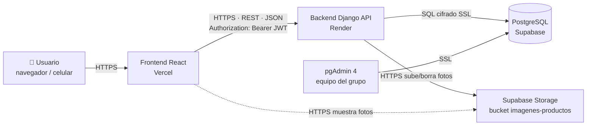
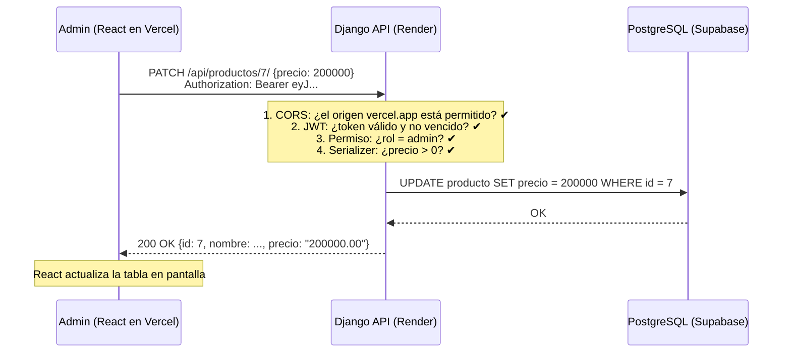

# 01 · Arquitectura y diagnóstico (FASE 1)

## 1. ¿Cómo está armado el sistema?

GoldBracelets usa una arquitectura de **tres capas separadas** (también llamada *cliente-servidor desacoplado*). Cada capa vive en un servicio distinto de internet:



| Capa | Qué hace | Tecnología | Plataforma |
|---|---|---|---|
| **Presentación (FE)** | Dibuja las pantallas y envía lo que el usuario hace | React + Vite | Vercel |
| **Lógica (BE)** | Valida, aplica reglas (stock, descuentos, permisos) y expone la API | Django + DRF | Render |
| **Datos (BD)** | Guarda usuarios, productos, pedidos | PostgreSQL | Supabase |

**¿Por qué separarlas?**
- Se pueden desplegar y escalar por separado (si hay muchas visitas, Vercel lo absorbe sin tocar el backend).
- La seguridad queda en el backend: el navegador nunca habla directo con la base de datos.
- Corresponde a la **Fase 1 – Monolito modular** del documento de arquitectura: un solo backend dividido en módulos (auth, catálogo, tienda, admin).

> ✏️ **Corrección al documento de arquitectura:** el documento original menciona "Node.js/Spring Boot" como backend. El proyecto real usa **Python + Django REST Framework**, que cumple las mismas funciones (API REST, monolito modular, ORM con PostgreSQL). En la sustentación expliquen que se eligió Django por: ORM integrado, migraciones automáticas, panel de administración, seguridad por defecto (contraseñas con hash, protección CSRF/XSS) y curva de aprendizaje del equipo.

## 2. Protocolo de comunicación: REST

Elegimos **REST** (no GraphQL) porque:
- Es el estándar más común y sencillo de explicar y depurar (se puede probar en el navegador).
- Django REST Framework genera el CRUD con muy poco código (ViewSets + Router).
- Nuestras pantallas piden datos simples; GraphQL agregaría complejidad sin beneficio real.

### Ciclo de vida de UNA petición (ejemplo: el admin edita el precio)



### Códigos de respuesta que usa la API

| Código | Significado | Ejemplo |
|---|---|---|
| 200 OK | Todo bien | Listar productos |
| 201 Created | Se creó algo | Registro, nuevo producto, nuevo pedido |
| 400 Bad Request | Datos inválidos o regla de negocio | "El precio debe ser mayor a 0", "Stock insuficiente" |
| 401 Unauthorized | No enviaste token o venció | Entrar al carrito sin iniciar sesión |
| 403 Forbidden | Tienes sesión pero no permiso | Un cliente intenta crear productos |
| 404 Not Found | No existe | `/api/productos/9999/` |
| 409 Conflict | No se puede borrar por relaciones | Borrar un usuario que tiene pedidos |
| 429 Too Many Requests | Demasiados intentos | Más de 10 logins por minuto |
| 500 / 503 | Error del servidor / BD caída | Mensaje genérico, el detalle va al log |

## 3. Diagnóstico: problemas encontrados y cómo se corrigieron

| # | Problema encontrado | Impacto | Corrección |
|---|---|---|---|
| 1 | Las imágenes se guardaban en el **disco de Render**, pero la URL apuntaba a Supabase (dirección escrita a mano en el código) | Las fotos nuevas **nunca aparecían** y además Render borra su disco en cada despliegue | Nuevo `account/storage.py` que sube las fotos directo a **Supabase Storage**; la URL se arma con variables de entorno |
| 2 | `settings.py` sin commitear quitó **WhiteNoise** y `STATIC_ROOT` | `collectstatic` fallaba y el panel `/django-admin/` quedaba sin estilos en Render | Restaurado y documentado |
| 3 | `DEBUG=True` por defecto | En producción mostraría errores internos (riesgo de seguridad) | DEBUG se apaga solo en Render (`RENDER=true`) y se exige `DJANGO_SECRET_KEY` |
| 4 | CORS solo permitía `localhost` | El frontend en Vercel era **bloqueado por el navegador** | Orígenes configurables con `CORS_ALLOWED_ORIGINS` y `CORS_ALLOWED_ORIGIN_REGEXES` |
| 5 | Nueva ruta `/` usaba la plantilla `inicio.html` con `` inexistente | Error 500 en la página raíz del backend | `/` ahora responde un JSON de estado; `/api/salud/` para Render |
| 6 | Con **stock 0** el carrito permitía agregar (`if producto.stock and ...`) | Ventas de productos agotados | Regla en `services.agregar_al_carrito`: si stock = 0 → error "agotado" |
| 7 | El checkout bloqueaba las filas del carrito, no las del producto | Dos clientes podían comprar la última unidad a la vez | `select_for_update()` sobre los **productos** en orden fijo + transacción atómica |
| 8 | Código duplicado/muerto: `proyecto/proyecto/account`, `proyecto/proyecto/proyecto`, `appdjango/urls.py` (apuntaba a vistas que no existen), plantillas HTML antiguas | Confusión, imposible de explicar | Eliminado (queda en el historial de git). Las tablas antiguas de `appdjango` no se tocan en la BD |
| 9 | `ALLOWED_HOSTS` de Render repetido, `.gitignore` duplicado | Desorden | Limpieza |
| 10 | Sin manejo global de errores | Cada error con formato distinto; errores 500 en HTML | `account/exceptions.py`: todos los errores responden `{"detail": "...", "errors": {...}}` |
| 11 | Token de acceso de **8 horas**, sin cierre de sesión real | Si roban el token sirve todo el día | Access de 30 min + refresh de 1 día con rotación y **lista negra** al cerrar sesión |
| 12 | Sin límite de intentos de login | Ataques de fuerza bruta | Throttling: 10 intentos/minuto por IP |
| 13 | El seed reseteaba la contraseña del admin a un valor fijo en cada despliegue | Cualquiera que leyera el repo conocía la clave de producción | Solo la define al crearlo o si existe `SEED_ADMIN_PASSWORD` |
| 14 | Faltaban historias de usuario (recuperar contraseña, filtros, envío, pagos, reportes, inventario…) | Proyecto incompleto | Implementadas (ver [Sprints](08-sprints.md)) |
| 15 | Rutas de React en Vercel: al recargar `/carrito` daba 404 | Mala experiencia | `frontend/vercel.json` con *rewrite* a `index.html` |
| 16 | Vistas, validación y reglas mezcladas en un solo `views.py` de 350 líneas | Difícil de mantener y explicar | Separación en capas: `views/` (HTTP) → `serializers.py` (validación) → `services.py` (reglas) → `models.py` (datos) |

## 4. Buenas prácticas aplicadas en la API

### 4.1 Estructura por capas (separación de responsabilidades)

```
Petición HTTP
   │
   ▼
urls.py ─────────► ¿Qué vista atiende esta URL?
   │
   ▼
views/*.py ──────► Recibe la petición, revisa PERMISOS, llama a lo demás, responde
   │
   ├─► serializers.py ► VALIDA datos de entrada y da formato JSON a la salida
   ├─► services.py ───► REGLAS del negocio (stock, descuentos, estados del pedido)
   │
   ▼
models.py ───────► Tablas (ORM) ──► PostgreSQL
```

### 4.2 Manejo global de errores
Configurado en `settings.py` → `REST_FRAMEWORK['EXCEPTION_HANDLER']`. Ver `account/exceptions.py`. El frontend siempre recibe:

```json
{ "detail": "El precio debe ser mayor a 0.", "errors": { "precio": ["El precio debe ser mayor a 0."] } }
```

y así puede mostrar el mensaje general arriba y cada error debajo de su campo.

### 4.3 Validación de datos (doble)
1. **En el navegador** (React): respuesta inmediata, sin esperar al servidor.
2. **En el servidor** (serializers): la validación que **realmente protege**, porque cualquiera puede saltarse el navegador.

### 4.4 Otras prácticas
- Configuración por **variables de entorno** (nada secreto en el código).
- **Pruebas automáticas** (`account/tests/test_api.py`, 24 pruebas).
- Consultas optimizadas: `select_related` / `prefetch_related` evitan el problema "N+1" (hacer 100 consultas en vez de 1).
- Índices en columnas de búsqueda (precio, estado, categoría).
- Endpoint de salud `/api/salud/` para el monitoreo de Render.
- Logs en consola (se ven en la pestaña *Logs* de Render).

## 5. Mapa de rutas de la API

Base local: `http://127.0.0.1:8000/api` · Producción: `https://<servicio>.onrender.com/api`

### Públicas (sin iniciar sesión)
| Método | Ruta | Descripción |
|---|---|---|
| GET | `/salud/` | Estado del servidor y de la BD |
| POST | `/auth/registro/` | Crear cuenta de cliente |
| POST | `/auth/login/` | Login de **clientes** (usuario o correo) |
| POST | `/auth/admin/login/` | Login de **administradores** |
| POST | `/auth/refresh/` | Renovar el token access |
| POST | `/auth/password/recuperar/` | Enviar enlace de recuperación |
| POST | `/auth/password/restablecer/` | Guardar nueva contraseña con el enlace |
| GET | `/categorias/` | Categorías activas |
| GET | `/productos/` | Catálogo con filtros `?q=&categoria=&precio_min=&precio_max=&tipo_oro=&talla=&orden=&disponibles=` |
| GET | `/productos/{id}/` | Detalle y ficha técnica |
| GET | `/productos/destacados/` | Los 4 más vendidos |
| GET | `/productos/opciones/` | Listas para filtros (tipos de oro, quilates, tallas, métodos de pago) |

### Cliente (token de cliente)
| Método | Ruta | Descripción |
|---|---|---|
| GET / PUT | `/auth/me/` | Ver / actualizar mis datos |
| POST | `/auth/password/cambiar/` | Cambiar contraseña |
| POST | `/auth/logout/` | Cerrar sesión (invalida el refresh) |
| GET / POST / DELETE | `/carrito/` | Ver, agregar producto, vaciar |
| PATCH / DELETE | `/carrito/items/{id}/` | Cambiar cantidad / quitar |
| POST | `/checkout/` | Confirmar compra |
| GET | `/pedidos/` y `/pedidos/{id}/` | Mis pedidos / comprobante |
| POST | `/pedidos/{id}/cancelar/` | Cancelar (si no fue enviado) |

### Administrador (token de admin)
| Método | Ruta | Descripción |
|---|---|---|
| POST / PATCH / DELETE | `/productos/` y `/productos/{id}/` | CRUD de productos (con imagen) |
| POST | `/productos/{id}/visibilidad/` | Publicar / ocultar |
| POST / PATCH / DELETE | `/categorias/` y `/categorias/{id}/` | CRUD de categorías |
| GET | `/admin/dashboard/` | Indicadores y alertas |
| GET / PATCH | `/admin/pedidos/` y `/admin/pedidos/{id}/` | Historial, cambiar estado, guía |
| GET | `/admin/clientes/` | Clientes (orden alfabético, búsqueda) |
| GET | `/admin/inventario/` | Stock, valor, alertas |
| GET | `/admin/reportes/ingresos/` | Ingresos por día / mes / año |
| GET | `/admin/reportes/mas-vendidos/` | Ranking por unidades o ingresos |
| GET | `/admin/reportes/sin-ventas/` | Productos sin movimiento |

> 💡 En local, con `DJANGO_DEBUG=True`, puedes abrir cualquiera de estas rutas en el navegador (`http://127.0.0.1:8000/api/productos/`) y DRF muestra una página para probarlas.
