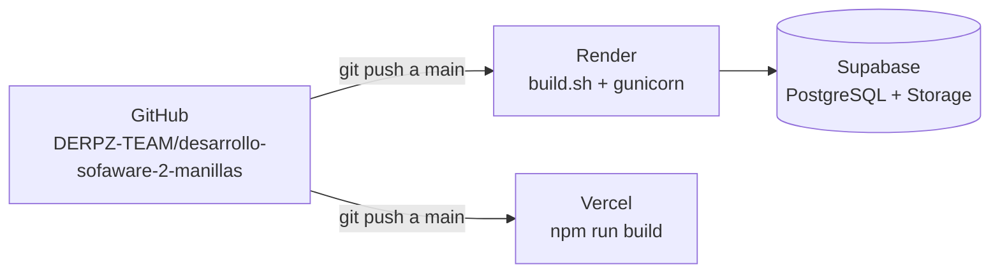

# 06 · Despliegue paso a paso: Supabase + Render + Vercel

Orden recomendado: **1) Base de datos → 2) Backend → 3) Frontend → 4) Volver a Render para poner la URL de Vercel en CORS.**



Cada `git push` a la rama `main` hace que Render y Vercel **vuelvan a desplegar solos** (despliegue continuo).

---

## Paso 1 · Base de datos

Tienen dos opciones. **Recomendado: Supabase** (ya lo usan, no expira y además guarda las imágenes).

### Opción A — Supabase (recomendada)
1. https://supabase.com → **New project** (o el existente). Región: la más cercana (ej. *East US*). Guardar la **Database password**.
2. Obtener la URL de conexión: botón **Connect** → *Connection string* → **Session pooler** → copiar y reemplazar `[YOUR-PASSWORD]`:
   ```
   postgresql://postgres.<ref>:<clave>@aws-0-us-east-1.pooler.supabase.com:5432/postgres
   ```
   *¿Por qué "pooler" y no "Direct"?* La conexión directa de Supabase usa IPv6, y Render no tiene salida IPv6: con "Direct" el backend no logra conectarse.
3. **Bucket de imágenes**: menú **Storage** → *New bucket* → nombre `imagenes-productos` → marcar **Public bucket** (para que las fotos se vean sin login).
4. **Service key**: *Project Settings → API Keys* → copiar la **`service_role` (secret)**. Esa va en Render como `SUPABASE_SERVICE_KEY`. ⚠️ Nunca en el frontend ni en GitHub.
5. URL del proyecto (`SUPABASE_URL`): *Project Settings → API → Project URL*, ej. `https://sxuavqduvjlcwioijotz.supabase.co`.

### Opción B — PostgreSQL de Render
1. Render → **New → PostgreSQL**. Name: `goldbracelets-db`, Database: `goldbracelets`, Region: la misma del backend (ej. *Oregon*), Plan: *Free*.
2. **Create Database** y esperar el estado *Available*.
3. En **Connections**:
   - **Internal Database URL** → usar en el backend de Render (`DATABASE_URL`): más rápida y no sale a internet.
   - **External Database URL** → usar en pgAdmin (agregar tu IP en *Access Control*).
4. ⚠️ El plan gratis de Render PostgreSQL **expira a los 30 días**. Para el proyecto final se recomienda Supabase.
5. Con esta opción las imágenes igual deben ir a Supabase Storage (pasos 3–5 de la opción A).

---

## Paso 2 · Backend en Render

### Opción rápida: Blueprint
El repositorio trae `render.yaml`. Render → **New → Blueprint** → conectar el repo → Render lee el archivo y crea el servicio; solo pide llenar las variables marcadas como `sync: false`.

### Opción manual (Web Service)
1. Render → **New → Web Service** → *Connect a repository* → elegir `DERPZ-TEAM/desarrollo-sofaware-2-manillas` (autorizar GitHub si lo pide).
2. Configuración:

   | Campo | Valor |
   |---|---|
   | Name | `desarrollo-sofaware-2-manillas` (define la URL `https://<name>.onrender.com`) |
   | Region | Oregon (o la más cercana a la BD) |
   | Branch | `main` |
   | **Root Directory** | `proyecto` |
   | Runtime | Python 3 |
   | **Build Command** | `bash build.sh` |
   | **Start Command** | `gunicorn proyecto.wsgi:application --bind 0.0.0.0:$PORT --workers 2 --timeout 60` |
   | Instance type | Free |
   | Health Check Path (Advanced) | `/api/salud/` |

3. **Environment** → agregar las variables de la tabla de [05-variables-de-entorno.md](05-variables-de-entorno.md#plantillas) (mínimo: `DJANGO_SECRET_KEY`, `DATABASE_URL`, `SUPABASE_URL`, `SUPABASE_SERVICE_KEY`, `CORS_ALLOWED_ORIGINS`, `FRONTEND_URL`, `PYTHON_VERSION`).
4. **Create Web Service**. En **Logs** debe verse:
   ```
   pip install -r requirements.txt ... OK
   collectstatic ... 160 static files copied
   Applying account.0006_campos_ficha_envio_reportes... OK
   Datos iniciales listos.
   Listening at: http://0.0.0.0:10000
   ```
5. Probar: `https://<name>.onrender.com/api/salud/` → `{"estado":"ok","base_de_datos":"ok"}`.

**¿Qué hace `build.sh`?** Instala librerías → junta los estáticos del panel de Django → aplica migraciones → crea admin/categorías si faltan. Si algún paso falla, el despliegue se cancela y sigue funcionando la versión anterior.

**¿Qué es gunicorn?** El servidor de producción de Python. `runserver` es solo para desarrollo (un usuario, sin rendimiento). `--workers 2` = atiende 2 peticiones en paralelo.

---

## Paso 3 · Frontend en Vercel

1. https://vercel.com → **Add New → Project** → *Import Git Repository* → `desarrollo-sofaware-2-manillas`.
2. Configuración:

   | Campo | Valor |
   |---|---|
   | Framework Preset | **Vite** |
   | **Root Directory** | `frontend` |
   | Build Command | `npm run build` |
   | Output Directory | `dist` |
   | Install Command | `npm install` |

3. **Environment Variables** → `VITE_API_URL` = `https://<name>.onrender.com/api` (con **https** y sin `/` final).
4. **Deploy**. Vercel entrega una URL como `https://desarrollo-sofaware-2-manillas.vercel.app`.

### Rutas en producción
React maneja las rutas en el navegador (`/carrito`, `/admin/productos`). Si alguien recarga la página en `/carrito`, Vercel buscaría un archivo `carrito.html` que no existe → 404. Por eso `frontend/vercel.json` tiene:
```json
"rewrites": [{ "source": "/(.*)", "destination": "/index.html" }]
```
que devuelve siempre `index.html` y React muestra la pantalla correcta.

---

## Paso 4 · Cerrar el círculo (CORS)
1. Copiar la URL final de Vercel.
2. Render → servicio → **Environment**:
   - `CORS_ALLOWED_ORIGINS` = `https://desarrollo-sofaware-2-manillas.vercel.app`
   - `FRONTEND_URL` = la misma URL
3. **Save Changes** (Render redespliega solo).
4. Abrir la tienda en Vercel → F12 → pestaña **Network**: las peticiones a `onrender.com/api/...` deben responder 200 sin errores de CORS.

---

## Paso 5 · Verificación final (checklist de la demo)
- [ ] `https://<render>/api/salud/` → base_de_datos "ok"
- [ ] La portada de Vercel muestra productos
- [ ] Registro de un cliente nuevo
- [ ] Agregar 6 piezas → aparece descuento 5 %
- [ ] Checkout → comprobante del pedido
- [ ] `/admin/ingresar` con el admin → escritorio con la venta
- [ ] Crear producto **con imagen** → la imagen se ve en la tienda (está en Supabase Storage)
- [ ] Cambiar estado del pedido a confirmado → enviado (con guía)
- [ ] Reportes muestran el ingreso
- [ ] Recargar en `/carrito` no da 404

## Problemas frecuentes

| Síntoma | Causa probable | Solución |
|---|---|---|
| Build falla con `Permission denied` | Se puso `./build.sh` y el archivo no tiene permiso de ejecución (pasa al subir desde Windows) | Usar `bash build.sh` |
| `ImproperlyConfigured: Falta DJANGO_SECRET_KEY` | No se definió la variable | Agregarla en Environment |
| `could not translate host name` / timeout a la BD | URL directa IPv6 de Supabase | Usar la URL del **Session pooler** |
| `password authentication failed` | Clave mal copiada o con caracteres especiales | Reescribirla; si tiene `@ # /` codificarlos (`@` → `%40`) |
| Las imágenes nuevas no aparecen | Falta `SUPABASE_SERVICE_KEY` o el bucket no es público | Revisar variables y marcar el bucket como *Public* |
| CORS bloqueado | Origen no permitido | Ver doc 03, sección 4 |
| Primera carga lenta (~50 s) | Plan gratis de Render se duerme | Abrir `/api/salud/` 1 minuto antes de presentar |

## Disponibilidad: el "sueño" del plan gratis

El plan gratis de Render **apaga el backend tras unos 15 minutos sin visitas** y tarda cerca de un minuto en despertar. Para manejarlo hay dos capas:

1. **La página sabe esperar** (`frontend/src/api/client.js`): si el servidor no responde, muestra "Estamos activando el servidor" y espera a `/api/salud/`. Luego repite solo las consultas y los inicios de sesión. Una compra **nunca** se repite sola, para no crear pedidos dobles.
2. **Tarea automática** (`.github/workflows/mantener-activo.yml`): GitHub Actions visita `/api/salud/` cada 10 minutos. Esa ruta también consulta la base de datos, lo que evita que Supabase pause el proyecto por inactividad. Se puede ver y ejecutar a mano en la pestaña **Actions** del repositorio.

**Límites honestos:** GitHub puede retrasar las tareas programadas y las desactiva tras 60 días sin actividad en el repositorio. Para mayor constancia, agregar un monitor externo gratis (UptimeRobot o cron-job.org) sobre `/api/salud/` cada 5 minutos. El plan gratis de Render da 750 horas al mes, suficientes para un solo servicio encendido todo el mes. Ningún plan gratis garantiza disponibilidad; para una tienda real con clientes se recomienda un plan de pago de Render, que no se duerme.

## Flujo de trabajo en equipo con Git
```bash
git checkout main
git pull                          # traer lo último
git checkout -b feature/mi-cambio # rama propia
# ... hacer cambios y probar en local ...
git add .
git commit -m "Describe el cambio"
git push -u origin feature/mi-cambio
# En GitHub: abrir Pull Request -> revisión de un compañero -> Merge a main
# Render y Vercel despliegan automáticamente al hacer merge a main
```
